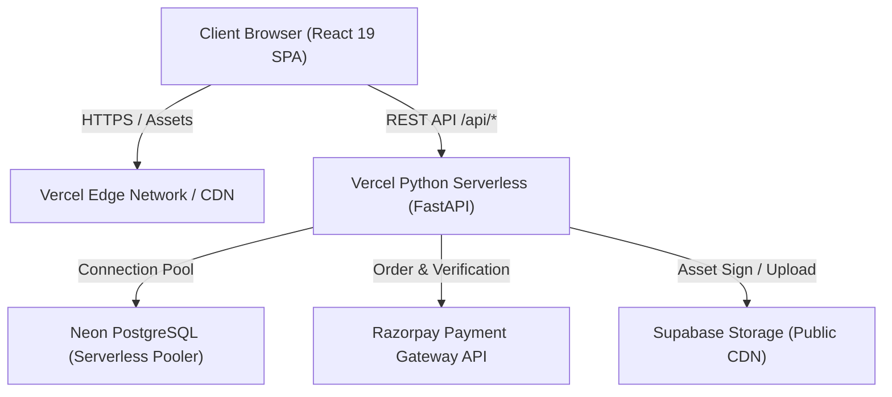

# Architecture & System Design — Mehndi By Dhirali

## 1. System Overview

Mehndi By Dhirali is a full-stack e-commerce application designed for deployment on 100% free hosting tiers (Vercel Frontend + Vercel Python Serverless Functions + Neon PostgreSQL + Supabase Storage + Razorpay Test Mode).



## 2. Directory Monorepo Structure

```
mehndi-by-dhirali/
├── frontend/                  # React 19 + TypeScript + Tailwind CSS v4
│   ├── src/
│   │   ├── components/        # Layout, cart, home, products, ui
│   │   ├── pages/             # Storefront, account, policies, admin
│   │   ├── lib/               # API client, Zustand stores, utils
│   │   ├── types/             # Strict shared interfaces
│   │   ├── App.tsx            # React Router route registry
│   │   └── main.tsx           # Entry mounting
│   ├── package.json
│   └── vite.config.ts
├── backend/                   # FastAPI + SQLAlchemy 2.x
│   ├── app/
│   │   ├── api/routes/        # REST endpoints (auth, products, orders, payments, admin)
│   │   ├── core/              # Config (Pydantic Settings), security, deps
│   │   ├── db/                # Base & Session management
│   │   ├── models/            # SQLAlchemy ORM models
│   │   ├── schemas/           # Pydantic v2 validation models
│   │   └── integrations/      # Razorpay & Supabase clients
│   ├── migrations/            # Alembic database migrations
│   ├── tests/                 # Automated pytest suite (14 test cases)
│   ├── requirements.txt
│   └── .env.example
├── api/
│   └── index.py               # Vercel Serverless Function entry point
├── docs/                      # Technical manuals
├── vercel.json                # Single monorepo Vercel deployment configuration
└── README.md
```

## 3. Financial Integrity & State Machine

- **Integer Minor Units:** All monetary values are represented strictly as integers in paise (e.g. ₹120.00 = 12000 paise). Floating-point calculation is prohibited.
- **Server-Authoritative Pricing:** The frontend submits only product IDs and requested quantities. The FastAPI backend queries current database prices and calculates subtotals, shipping thresholds (free on orders >= ₹999, else ₹70), and final totals.
- **Order State Machine:**
  `pending_payment` -> `paid` -> `processing` -> `shipped` -> `delivered`
- **Idempotency:** Payment callbacks and webhook events verify against `razorpay_order_id` and deduplicate `event_id` in the `payment_events` table before modifying state or decrementing inventory.
